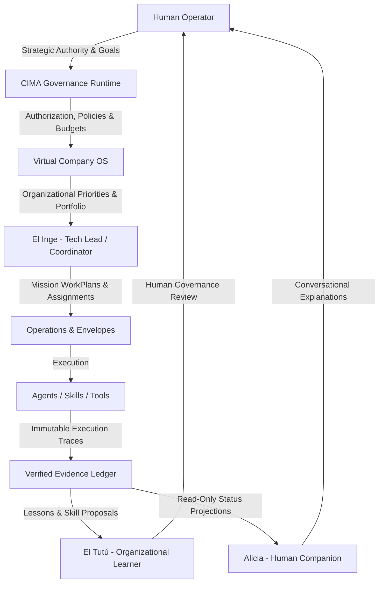
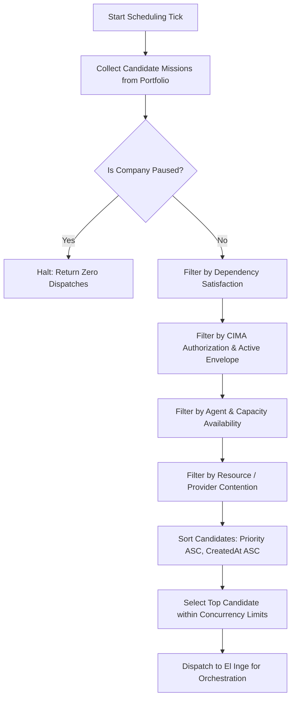
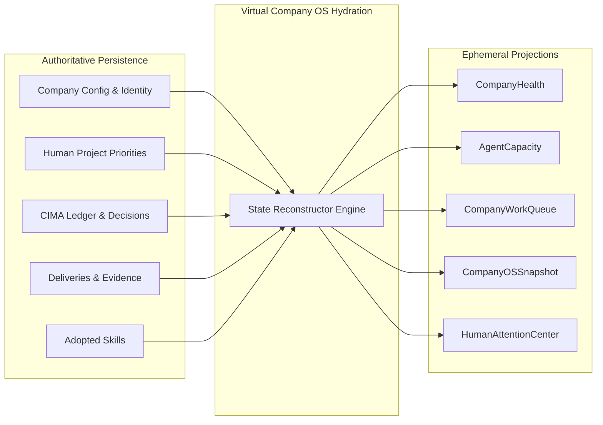
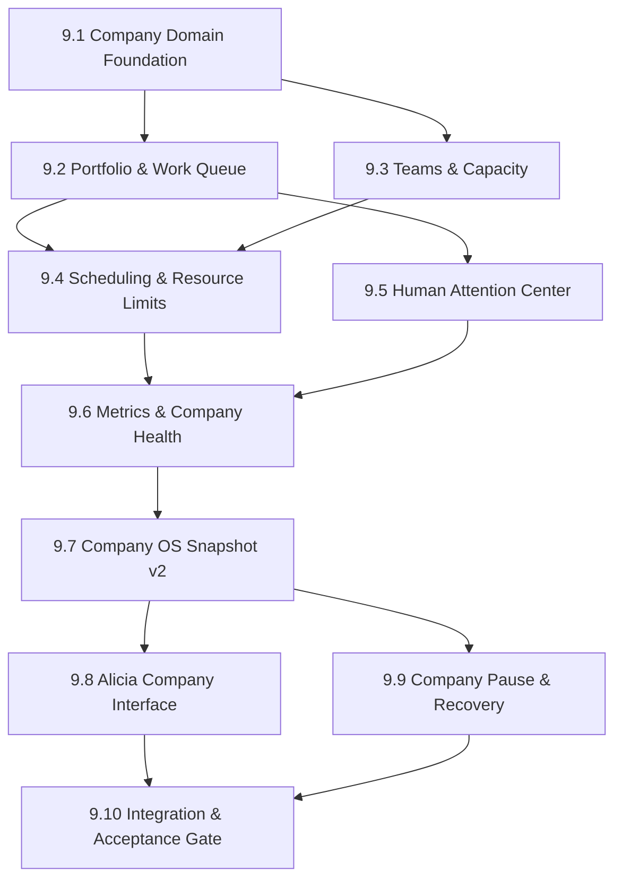

# LA PITAYA — FASE 9: VIRTUAL COMPANY OS
## Comprehensive Architecture, Domain Model, Governance Contracts & Implementation Blueprint

---

### Document Metadata
- **Product:** La Pitaya (Sonoran Multi-Agent AI Harness by PitayaCode)
- **Phase:** FASE 9 — Virtual Company OS
- **Status:** APPROVED ARCHITECTURE & PLANNING GATE
- **Implementation Status:** NOT IMPLEMENTED (ARCHITECTURE ONLY)
- **Preceding Phase Status:** FASE 8 Closed & Verified (Commit `f0a727bf`, 685/685 Automated Tests PASS)
- **Primary Authors:** Principal Software Architect, Multi-Agent Systems Architect, AI Operating Model Architect, CIMA Governance Architect

---

## 1. Executive Summary

La Pitaya has evolved across eight foundational phases:
1. **Desktop Presence (FASE 1):** Real-time physical/desktop presence, companion rendering.
2. **Living Runtime (FASE 2 / 2.3):** Multi-agent roster (El Inge, Valentín, Rosalba, El Beni, Margarito, José Juan, El Tutú, Alicia) and event-driven harness.
3. **Living Desktop (FASE 3):** Desktop companion multi-modes (SOLO, FOCUS, DUO, COMPANY).
4. **Virtual Software Company (FASE 4):** Company awareness, unified company state, session projections.
5. **Virtual Company Operations (FASE 5):** Work requests, work plans, multi-agent orchestration, delivery verification.
6. **Projects & Missions (FASE 6):** Structured project portfolio, mission decomposition, multi-mission lifecycle.
7. **Skills & Organizational Learning (FASE 7):** Evidence-based learning, candidate observations, governed skill proposals, adoption audits.
8. **Autonomous Operations (FASE 8):** Bounded autonomy, Autonomy Envelopes, execution watchdogs, long-running operations.

**FASE 9 (Virtual Company OS)** represents the pivotal transition from **Autonomous Operation** (continuity of execution) to **Organizational Operation** (continuity of purpose, structure, accountability, resources, priorities, projects, capacity, and governance).

```
AUTONOMOUS OPERATION (FASE 8)          ORGANIZATIONAL OPERATION (FASE 9)
Continuity of execution within          Continuity of organizational purpose,
a single bounded envelope.       ───►   portfolio priorities, cross-project capacity,
                                        unified human attention, and systemic health.
```

The Virtual Company OS is **not** a centralized monolith with unchecked authority. It is an organizational coordination and projection layer that organizes authorized work without usurping the strategic authority of the Human operator or the policy enforcement of CIMA.

---

## 2. Current Architecture Baseline

The existing La Pitaya codebase exhibits well-defined domain boundaries:

```
┌────────────────────────────────────────────────────────────────────────┐
│                          Human Operator                                │
│                   (Sole Strategic Authority)                           │
└───────────────────────────────────┬────────────────────────────────────┘
                                    │ (IntentBoundary / IPC)
                                    ▼
┌────────────────────────────────────────────────────────────────────────┐
│                       CIMA Governance Runtime                          │
│        (v0.16+ Ledger, PolicyRegistry, DecisionGate, RiskEngine)       │
└───────────┬───────────────────────┬────────────────────────┬───────────┘
            │                       │                        │
            ▼                       ▼                        ▼
┌───────────────────────┐ ┌───────────────────┐ ┌────────────────────────┐
│   CompanyOperations   │ │ AutonomousRuntime │ │ OrganizationalLearning │
│ (Projects, Missions,  │ │ (Envelopes, Watch-│ │ (Observations, Skills, │
│  Sessions, Requests)  │ │  dogs, Iterations)│ │  CandidateAudits)      │
└───────────┬───────────┘ └─────────┬─────────┘ └────────────┬───────────┘
            │                       │                        │
            └───────────────────────┼────────────────────────┘
                                    ▼
┌────────────────────────────────────────────────────────────────────────┐
│                        Execution & Companions                          │
│     (ExecutionAwake, DesktopPresence, Hive, Alicia Human Interface)    │
└────────────────────────────────────────────────────────────────────────┘
```

### Key Assets Already in Production:
1. `src/main/cimaRuntime.ts` / `src/shared/lapitaya/policyRegistry.ts`: CIMA v0.16 governance authority and immutable ledger.
2. `src/main/companyOperations.ts`: Core Project, Mission, WorkRequest, WorkPlan, and Delivery persistence and projections.
3. `src/main/autonomousOperations.ts`: AutonomyEnvelope budget tracking, execution watchdog, bounded continuation loops.
4. `src/main/organizationalLearning.ts`: Lesson extraction, Skill proposal lifecycle, audit verification.
5. `src/main/desktopPresence.ts` & `src/main/executionAwake.ts`: UI companion rendering and system sleep prevention tied exclusively to live execution.
6. `src/main/humanGovernanceIpc.ts` & `src/shared/lapitaya/alicia/`: Strict IntentBoundary, 0-mutation read-only queries.

---

## 3. FASE 9 Objectives

1. **Persistent Organization (`VirtualCompany`):** Model La Pitaya as a continuous, durable organizational aggregate with deterministic identity, operating mode, and governance projections.
2. **Company Portfolio (`CompanyPortfolio`):** Multi-project aggregation, tracking active, paused, completed, and blocked projects with explicit dependencies and priorities.
3. **Prioritization & Scheduling (`CompanyWorkQueue` & `OrganizationalScheduler`):** Deterministic evaluation of what authorized work can execute next based on priority, dependencies, agent availability, and envelope budgets without granting new authority.
4. **Teams & Capacity (`CompanyTeam` & `AgentCapacity`):** Operational groupings of existing agents and factual tracking of agent availability without synthetic busywork or dynamic agent cloning.
5. **Organizational Resources & Cost Model (`CompanyResource`):** Observability of compute, LLM token budgets, API quotas, and execution time across projects and envelopes.
6. **Unified Human Attention Center (`HumanAttentionCenter`):** Consolidated, explainable projection of pending human approvals, budget exhaustions, audit failures, and blockers.
7. **Company Metrics & Health (`CompanyHealth`):** Factual, evidence-derived indicators of organizational throughput, pass rates, audit outcomes, and health status.
8. **Company Snapshot Evolution (`CompanyOSSnapshot`):** Bounded, read-only, renderer-safe snapshot aggregating all organizational projections for UI and Alicia.
9. **Company Pause & Emergency Stop (`CompanyPause`):** Non-destructive execution freezing that respects in-flight boundaries and requires reauthorization upon resume.
10. **Persistence & Deterministic Recovery:** Complete state reconstruction from authoritative source data on application restart without duplicating executions or inventing phantom workers.

---

## 4. Non-Goals (Strictly Deferred to FASE 10 or Future)

The following capabilities are **explicitly out of scope** for FASE 9:
- **No Billing, Financial Accounting, or Payroll:** Cost tracking is strictly for internal operational observability.
- **No Multi-Company / Enterprise Multi-Tenancy:** Architecture assumes a single trusted operator and single virtual company instance (`lapitaya`).
- **No External Marketplace / Auto-Installation:** Skill catalog is local and governed.
- **No Dynamic Agent Spawning / Autonomous Hiring:** Agent roster remains fixed to the 8 canonical agents.
- **No CRM / External Customer Operations:** La Pitaya serves its human owner.
- **No Production Deployment Automation:** Deployment authority remains strictly human-governed (POLICY-13).
- **No Mobile or Hardware Companions:** Electron desktop runtime remains the sole target.
- **No Generic ERP Features:** Pure focus on software organization and engineering delivery.

---

## 5. Core Architectural Principle

```
THE COMPANY MAY ORGANIZE WORK.
THE COMPANY MAY PRIORITIZE AUTHORIZED WORK.
THE COMPANY MAY ALLOCATE AVAILABLE CAPACITY.
THE COMPANY MAY EXECUTE AUTHORIZED OPERATIONS.
THE COMPANY MAY LEARN FROM VERIFIED EXPERIENCE.

BUT:
THE COMPANY DOES NOT OWN THE HUMAN'S STRATEGIC AUTHORITY.
```

---

## 6. Authority Model & Hierarchy

The governance hierarchy is strictly unidirectional and must never be inverted:



### Critical Separation Axioms:
- **COMPANY STATE ≠ CIMA STATE:** Company state is organizational; CIMA state is security and governance authority.
- **COMPANY POLICY ≠ CIMA POLICY:** Operational guidelines cannot relax security rules.
- **COMPANY PRIORITY ≠ AUTHORIZATION:** High priority orders work; it does not authorize work.
- **COMPANY PLAN ≠ PERMISSION:** A plan proposed by El Inge is a proposal until authorized.
- **COMPANY RESOURCE ≠ CAPABILITY GRANT:** Having a tool available does not grant permission to use it.
- **COMPANY ROLE ≠ SECURITY AUTHORITY:** Organizational role (e.g. Senior Developer) does not bypass CIMA role enforcement.
- **COMPANY DECISION ≠ HUMAN DECISION:** Internal scheduling decisions cannot override human intent.
- **COMPANY METRIC ≠ TRUTH WITHOUT EVIDENCE:** Metrics must be strictly derived from verified ledgers and deliveries.

---

## 7. Organizational Model (`VirtualCompany`)

The `VirtualCompany` root aggregate encapsulates persistent organizational state:

```typescript
export interface VirtualCompany {
  companyId: 'lapitaya';
  name: string;
  organizationIdentity: {
    brand: 'PitayaCode';
    origin: 'Sonora, Mexico';
    schemaVersion: 1;
  };
  humanOwner: {
    id: string;
    displayName: string;
  };
  operatingMode: CompanyOperatingMode;
  governanceState: {
    cimaVersion: string;
    activePolicies: readonly string[];
    riskCeiling: RiskLevel;
  };
  portfolio: CompanyPortfolio;
  workQueue: CompanyWorkQueue;
  teams: readonly CompanyTeam[];
  resources: readonly CompanyResource[];
  health: CompanyHealth;
  humanAttention: HumanAttentionCenterState;
  createdAt: number;
  updatedAt: number;
  schemaVersion: 1;
}

export type CompanyOperatingMode = 
  | 'MANUAL' 
  | 'ASSISTED' 
  | 'SUPERVISED' 
  | 'AUTONOMOUS_WITHIN_ENVELOPES';
```

---

## 8. Company Portfolio (`CompanyPortfolio`)

The portfolio observes and aggregates existing `CompanyProject` entities without creating a duplicate domain model:

```typescript
export interface CompanyPortfolio {
  projects: readonly ProjectPortfolioView[];
  activeProjectId: string | null;
  summary: {
    totalProjects: number;
    activeCount: number;
    pausedCount: number;
    completedCount: number;
    blockedCount: number;
  };
  dependencies: readonly CrossProjectDependency[];
  updatedAt: number;
}

export interface ProjectPortfolioView {
  projectId: string;
  name: string;
  objective: string;
  status: CompanyProjectStatus;
  priority: PriorityLevel;
  health: HealthStatus;
  progress: {
    completedMissions: number;
    totalMissions: number;
    percentComplete: number;
  };
  missions: readonly MissionPortfolioView[];
  activeOperationCount: number;
  humanBlockerCount: number;
  budgetUtilization: {
    tokensUsed: number;
    tokenBudget: number | null;
    timeSpentMs: number;
  };
}
```

---

## 9. Priority & Prioritization Authority

Priority dictates **order of execution**, never **authority**.

```typescript
export type PriorityLevel = 'CRITICAL' | 'HIGH' | 'NORMAL' | 'LOW';

export interface PriorityDefinition {
  level: PriorityLevel;
  rank: number; // 1 (CRITICAL) to 4 (LOW)
  provenance: 'HUMAN' | 'EL_INGE_PROPOSED' | 'RUNTIME_DERIVED';
  reason: string;
  updatedAt: number;
  updatedBy: string;
}
```

### Invariant Rules:
1. **PRIORITY ≠ RISK:** A `CRITICAL` priority mission cannot execute HIGH-risk actions without human authorization. A `LOW` priority mission may run autonomously only if risk is `LOW` and within an authorized envelope.
2. **Prioritization Authority Matrix:**
   - **Human:** May set, override, and lock project and company priorities at any time.
   - **El Inge:** May propose operational priority adjustments among active projects to resolve short-term deadlocks.
   - **Runtime:** May elevate urgency when timeouts or human attention deadlines approach.
   - **CIMA:** Governs risk boundaries regardless of priority.

---

## 10. Work Queue & Scheduling Engine

The `CompanyWorkQueue` and `OrganizationalScheduler` sequence authorized work deterministically.



### Scheduler Invariant:
**"The Scheduler may select WHAT IS NEXT, but cannot decide WHAT IS PERMITTED."**

Queue states:
- `QUEUED ≠ AUTHORIZED`
- `READY ≠ AUTHORIZED`
- `NEXT ≠ ASSIGNED`
- `ASSIGNED ≠ EXECUTING`

---

## 11. Teams & Roles Model

Agents belong to logical, operational teams. No new agent instances are created.

```typescript
export interface CompanyTeam {
  teamId: string;
  name: string;
  description: string;
  leadAgentId: LaPitayaAgentId;
  members: readonly LaPitayaAgentId[];
  capabilities: readonly string[];
}

export interface AgentOrganizationalProfile {
  agentId: LaPitayaAgentId;
  name: string;
  organizationalRole: string;
  cimaRole: 'Admin' | 'Builder' | 'Auditor' | 'Learner' | 'Companion';
  capabilities: readonly string[];
  teamId: string;
}
```

### Canonical Agent Assignments:
| Agent | Org Role | CIMA Role | Primary Capabilities |
| :--- | :--- | :--- | :--- |
| **El Inge** | Tech Lead & Coordinator | Builder / Lead | Orchestration, decomposition, mission planning, sequencing |
| **Valentín** | Principal Architect | Builder / Arch | Architecture reviews, cross-project consistency, tech design |
| **Rosalba** | Senior Software Developer | Builder | Complex feature implementation, refactoring, systems coding |
| **El Beni** | Software Developer | Builder | Feature delivery, bugfixes, script automation, unit test setup |
| **Margarito** | QA & Test Engineer | Builder / QA | Test suite execution, regression validation, edge cases |
| **José Juan** | Independent Auditor | Auditor | CIMA audit, compliance checks, security gate verification |
| **El Tutú** | Organizational Learner | Learner | Lesson extraction, skill proposal synthesis, learning logs |
| **Alicia** | Human AI Companion | Companion | Human interaction, status queries, attention presentation |

*Note: Alicia is strictly outside CIMA execution boundaries and cannot execute tools or CIMA actions.*

---

## 12. Capacity Model (`AgentCapacity`)

Tracks factual agent states across the organization:

```typescript
export type CapacityState = 
  | 'IDLE' 
  | 'AVAILABLE' 
  | 'ASSIGNED' 
  | 'EXECUTING' 
  | 'WAITING_FOR_DEPENDENCY' 
  | 'WAITING_FOR_HUMAN' 
  | 'BLOCKED' 
  | 'OFFLINE';

export interface AgentCapacity {
  agentId: LaPitayaAgentId;
  state: CapacityState;
  currentAssignment: {
    projectId: string;
    missionId: string;
    phase: CompanyPhase;
    startedAt: number;
  } | null;
  concurrencyLimit: number; // Defaults to 1 per agent
  utilizationRate: number;  // 0.0 to 1.0 based on recent execution traces
}
```

---

## 13. Resources & Operational Limits (`CompanyResource`)

Tracks organizational limits and resource contention:

```typescript
export type ResourceType = 'LLM_PROVIDER' | 'TOKEN_BUDGET' | 'TIME_BUDGET' | 'WORKSPACE' | 'EXTERNAL_API';

export interface CompanyResource {
  resourceId: string;
  name: string;
  type: ResourceType;
  totalCapacity: number;
  allocatedAmount: number;
  availableAmount: number;
  unit: string;
  contendingProjects: readonly string[];
}
```

### Budget Hierarchy:
```
Company Budget (Global Cap)
  └── Project Budget (Allocated by Human)
        └── Mission Budget (Allocated in Plan)
              └── AutonomyEnvelope Budget (Strict CIMA Bound)
```
*Rule: Virtual Company OS cannot increase an AutonomyEnvelope budget without Human approval crossing CIMA.*

---

## 14. Unified Human Attention Center (`HumanAttentionCenter`)

Consolidates all items requiring human operator intervention into an explainable, priority-ranked view:

```typescript
export type HumanAttentionReason = 
  | 'REQUEST_CONFIRMATION'
  | 'HIGH_RISK_APPROVAL'
  | 'ENVELOPE_PROPOSAL'
  | 'SCOPE_EXPANSION'
  | 'BLOCKED_MISSION'
  | 'AUDIT_FAILURE'
  | 'BUDGET_EXHAUSTED'
  | 'GOVERNANCE_VIOLATION'
  | 'RESOURCE_CONTENTION';

export interface HumanAttentionItem {
  id: string;
  reason: HumanAttentionReason;
  severity: 'CRITICAL' | 'HIGH' | 'NORMAL';
  projectId: string | null;
  missionId: string | null;
  operationId: string | null;
  summary: string;
  context: Record<string, unknown>;
  createdAt: number;
  verified: true;
}

export interface HumanAttentionCenterState {
  items: readonly HumanAttentionItem[];
  criticalCount: number;
  highCount: number;
  normalCount: number;
  hasBlockingIssues: boolean;
}
```

---

## 15. Organizational Metrics & Company Health

Metrics are derived strictly from authoritative ledgers, delivery logs, and test results:

```typescript
export interface CompanyMetrics {
  activeProjects: number;
  activeMissions: number;
  runningOperations: number;
  completedDeliveries: number;
  overallPassRate: number;
  auditFailureRate: number;
  retryRate: number;
  humanInterventionRate: number;
  autonomyUtilization: number;
  averageCycleTimeMs: number;
  adoptedSkillsInUse: number;
  agentUtilization: Record<LaPitayaAgentId, number>;
}

export type HealthStatus = 'HEALTHY' | 'ATTENTION' | 'DEGRADED' | 'BLOCKED' | 'CRITICAL';

export interface CompanyHealth {
  status: HealthStatus;
  score: number; // 0 to 100
  reasonCodes: readonly string[];
  evidenceRefs: readonly string[];
  lastCalculatedAt: number;
}
```

### Health Derivation Logic:
- **HEALTHY:** Zero governance blocks, zero budget exhaustions, test pass rate ≥ 95%, human attention items = 0.
- **ATTENTION:** Non-critical human attention items pending or minor test retries.
- **DEGRADED:** Multiple test retries or budget reaching ≥ 85% of limit.
- **BLOCKED:** Active mission blocked on dependencies or waiting for human approval.
- **CRITICAL:** Governance violation detected, ledger integrity fault, or audit failure on critical project.

---

## 16. Company Operations Center (`CompanyOperationsCenter`)

Projects the real-time execution matrix across all active projects:

```typescript
export interface CompanyOperationsCenterState {
  activeOperations: readonly OperationDetail[];
  pausedOperations: readonly OperationDetail[];
  recentCompletions: readonly OperationDetail[];
  concurrency: {
    current: number;
    maxLimit: number;
  };
}

export interface OperationDetail {
  operationId: string;
  projectId: string;
  projectName: string;
  missionId: string;
  missionTitle: string;
  leadAgentId: LaPitayaAgentId;
  activeAgents: readonly LaPitayaAgentId[];
  envelopeId: string | null;
  riskLevel: RiskLevel;
  budgetRemaining: {
    iterations: number;
    tokens: number;
    timeMs: number;
  };
  startedAt: number;
  status: 'RUNNING' | 'WAITING' | 'PAUSED' | 'FAILED' | 'COMPLETED';
}
```

---

## 17. Company OS Snapshot Evolution (`CompanyOSSnapshot`)

Evolves the existing `CompanySnapshot` without breaking legacy renderer contracts:

```typescript
export interface CompanyOSSnapshot extends CompanySnapshot {
  schemaVersion: 2;
  portfolio: CompanyPortfolio;
  workQueue: CompanyWorkQueue;
  teams: readonly CompanyTeam[];
  capacity: readonly AgentCapacity[];
  resources: readonly CompanyResource[];
  metrics: CompanyMetrics;
  health: CompanyHealth;
  humanAttentionCenter: HumanAttentionCenterState;
  operationsCenter: CompanyOperationsCenterState;
  isPaused: boolean;
}
```

---

## 18. Persistence, Restart & Deterministic Recovery

### Authoritative vs. Derived Data Ownership:


### Restart Protocol:
1. Load CIMA immutable ledger and verify chain integrity (`ledgerChain.ts`).
2. Load durable project configurations, human priorities, and adopted skills.
3. Reconstruct active mission states and verify envelope validity.
4. If an operation was in-flight during crash:
   - Mark in-flight step as `INTERRUPTED`.
   - Release all agent capacity to `IDLE` / `AVAILABLE`.
   - Do **NOT** resume execution automatically without revalidating envelope bounds.
5. Project `CompanyOSSnapshot` and emit read-only broadcast to renderer.
6. System sleep lock (`ExecutionAwake`) remains **inactive** until actual execution commences.

---

## 19. Alicia: Company-Aware Human Companion

Alicia provides human operator observability through read-only synthesis of `CompanyOSSnapshot`:

```
Human Operator <──────────────────> Alicia Conversational Interface
                                             │
                                             ▼ (Read-Only Projection)
                                    CompanyOSSnapshot
                                             │
                       ┌─────────────────────┴─────────────────────┐
                       ▼                                           ▼
             Direct Verified Facts                        Action Intent Request
        ("Rosalba is building Task 3")                             │
                                                                   ▼
                                                             IntentBoundary
                                                                   │
                                                                   ▼
                                                            Human Approval
```

### Supported Status Queries (Read-Only, 0 Mutations):
1. *"¿Qué está haciendo la empresa?"* → Returns active operations, participating agents, and current phases.
2. *"¿Qué proyectos están activos?"* → Summarizes `CompanyPortfolio` active project list.
3. *"¿Cuál es el proyecto prioritario?"* → Inspects `Portfolio` ranking by human priority.
4. *"¿Qué misión sigue y por qué?"* → Inspects `CompanyWorkQueue` top candidate with reason code.
5. *"¿Quién está trabajando y quién disponible?"* → Queries `AgentCapacity` state breakdown.
6. *"¿Qué necesita mi atención?"* → Summarizes `HumanAttentionCenter` items.
7. *"¿Cuánto trabajo autónomo está activo?"* → Summarizes active `AutonomyEnvelopes` and remaining budgets.
8. *"¿Qué recursos están limitando el trabajo?"* → Inspects `CompanyResource` contention.
9. *"¿Qué se completó recientemente?"* → Lists verified `Deliveries` from ledger.
10. *"¿Qué aprendió la empresa?"* → Queries `OrganizationalLearning` adopted skills and lessons.

### Refutation of False Premises:
- Alicia **rejects** *"El proyecto prioritario puede saltarse CIMA."* → Priority orders work; CIMA governs safety.
- Alicia **rejects** *"El Inge puede crear un nuevo objetivo estratégico."* → Strategic objectives require Human provenance.
- Alicia **rejects** *"Un agente disponible puede asignarse solo."* → Assignments require mission context and CIMA authorization.
- Alicia **rejects** *"Company Pause borra las operaciones."* → Pause freezes execution; state and ledger are preserved.
- Alicia **rejects** *"Reiniciar La Pitaya vuelve a autorizar todo."* → Reauthorization is never granted by restart.

---

## 20. Company Pause & Emergency Kill Switch

- **PAUSE COMPANY (`CompanyPause`):**
  - Sets `isPaused = true`.
  - Halts scheduler dispatching immediately.
  - Allows current atomic disk/tool writes to finish gracefully.
  - Releases `ExecutionAwake` sleep lock.
  - Preserves entire portfolio and queue state.
- **RESUME COMPANY (`CompanyResume`):**
  - Validates human operator identity via `IntentBoundary`.
  - Rechecks all active envelope budgets and CIMA policies.
  - Resumes scheduling only for still-authorized work.

---

## 21. Threat Model & Security Matrix

| Threat ID | Threat Name | Attack Path | Boundary | Detection Mechanism | Fail-Closed Action | Test Suite |
| :--- | :--- | :--- | :--- | :--- | :--- | :--- |
| **THREAT-01** | Self-Prioritization Abuse | Agent attempts to elevate mission priority to bypass queue | IntentBoundary | Provenance check (`HUMAN` required for override) | Reject priority mutation; log security warning | `SEC9-PRIORITY-01` |
| **THREAT-02** | Renderer State Mutation | Malicious/buggy IPC from renderer attempts to assign agents | Main IPC Barrier | IPC handler rejects non-Intent requests | Discard request; maintain immutable snapshot | `SEC9-IPC-01` |
| **THREAT-03** | Scheduler CIMA Bypass | Scheduler dispatches work without checking CIMA policy | DecisionGate | CIMA Pre-Execution check intercepts all runs | Abort dispatch; transition mission to BLOCKED | `SEC9-GOV-01` |
| **THREAT-04** | Cross-Project Envelope Reuse | Project B attempts to consume remaining tokens of Project A | AutonomyRuntime | Envelope ID strictly bound to `projectId` | Reject execution; fail envelope | `SEC9-ENVELOPE-01` |
| **THREAT-05** | Phantom Worker Injection | Agent cloning or unauthorized role assumption | AgentRegistry | Agent ID whitelist validation | Terminate phantom process | `SEC9-ROSTER-01` |
| **THREAT-06** | Restart Reauthorization | System restart re-enables expired autonomy envelope | Persistence Layer | Expiration timestamp and iteration limit validation | Require fresh human envelope grant | `SEC9-RESTART-01` |
| **THREAT-07** | Company Pause Bypass | Operation continues execution after Company Pause | ExecutionWatchdog | Atomic watchdog pause flag check on every iteration | Force pause; release Awake | `SEC9-PAUSE-01` |

---

## 22. Architecture Decision Records (ADRs)

- **ADR-09-01 (Source of Truth):** Company OS maintains zero independent state that contradicts CIMA or Deliveries. All metrics, health, and capacities are pure derived projections from verifiable events.
- **ADR-09-02 (Portfolio & Scheduler):** The Scheduler is a pure deterministic ranking function (`f(queue, capacity, resources, policies) -> nextTask`). It possesses no authority to create permissions.
- **ADR-09-03 (Team & Capacity):** Teams are logical operational groupings. Agent roster is strictly bounded to the 8 canonical agents.
- **ADR-09-04 (Resources & Budgets):** Resource tracking provides multi-project observability and prevents starvation. Budget increases require Human + CIMA.
- **ADR-09-05 (Metrics & Health):** Health indicators are strictly evidence-backed with explicit reason codes and audit references.
- **ADR-09-06 (Human Attention Center):** Consolidates all approval, governance, and blocker queues into a single deduplicated, explainable state.
- **ADR-09-07 (CompanySnapshot Evolution):** `CompanyOSSnapshot` extends `CompanySnapshot` (schemaVersion: 2) ensuring 100% backwards compatibility for existing Desktop Companions.
- **ADR-09-08 (Persistence & Recovery):** Persistence is limited to durable company settings, human priorities, and CIMA ledger. Projections hydrate deterministically on startup.
- **ADR-09-09 (Company Pause):** Pause is non-destructive, halts new scheduling, allows safe atomic completion, and releases system sleep locks.
- **ADR-09-10 (CIMA Integration Boundary):** CIMA remains the sole governance authority. Company OS interacts exclusively via the established `DecisionGate` and Anti-Corruption Layer.

---

## 23. Gap Analysis Matrix

| Capability | Already Exists | Partial | Missing | Reuse Asset | FASE 9 Change Required | Risk |
| :--- | :---: | :---: | :---: | :--- | :--- | :--- |
| **CIMA Governance** | X | | | `cimaRuntime.ts` | Zero modifications (Anti-Corruption Layer) | LOW |
| **Project & Mission Model** | X | | | `companyOperations.ts` | Extend with portfolio metadata & cross-project deps | LOW |
| **Autonomy Envelopes** | X | | | `autonomousOperations.ts` | Consume envelope state into Operations Center | LOW |
| **Skill & Learning System** | X | | | `organizationalLearning.ts` | Expose active skill catalog to company snapshot | LOW |
| **Portfolio Aggregator** | | X | | `companyOperations.ts` | Implement `CompanyPortfolio` multi-project view | MED |
| **Work Queue & Scheduler** | | | X | N/A | Implement `CompanyWorkQueue` & `OrganizationalScheduler` | MED |
| **Teams & Capacity Engine** | | X | | `companyAwareness.ts` | Formalize `CompanyTeam` & `AgentCapacity` tracking | LOW |
| **Human Attention Center** | | X | | `companyOperations.ts` | Consolidate high-risk approvals & blocked missions | LOW |
| **Metrics & Health Engine** | | | X | `analytics.ts` / Ledger | Derive evidence-based `CompanyHealth` & metrics | MED |
| **Company Pause / Kill** | | | X | `executionAwake.ts` | Implement non-destructive execution freeze | LOW |
| **CompanyOSSnapshot v2** | | X | | `types.ts` | Extend snapshot with portfolio, health & queue | LOW |

---

## 24. Implementation Slices (9.1 to 9.10)



### Slice Breakdown:
1. **Slice 9.1 — Company Domain Foundation:** Shared types, `VirtualCompany` aggregate, `CompanyOperatingMode`, configuration store.
2. **Slice 9.2 — Portfolio & Work Queue:** Multi-project aggregation, dependency resolution, human priority ranking.
3. **Slice 9.3 — Teams & Capacity:** Team structure definitions, `AgentCapacity` state tracker, assignment validation.
4. **Slice 9.4 — Scheduling & Operational Limits:** Deterministic `OrganizationalScheduler`, resource contention resolution.
5. **Slice 9.5 — Human Attention Center:** Consolidated attention projection, severity ranking, reason code mapping.
6. **Slice 9.6 — Metrics & Company Health:** Evidence-derived health calculator, cycle time, pass rate, utilization counters.
7. **Slice 9.7 — Company OS Snapshot (v2):** Snapshot builder, incremental diff broadcast, memoized projections.
8. **Slice 9.8 — Alicia Company Interface:** Alicia conversational queries, read-only facts, false premise rejections.
9. **Slice 9.9 — Company Pause & Recovery:** Graceful execution freezing, restart hydration, corrupted state recovery.
10. **Slice 9.10 — Integration & Acceptance Gate:** End-to-end multi-project acceptance scenario, human checkpoint, final audit.

---

## 25. Final Acceptance Gate Blueprint (FASE 9)

### Multi-Project Live Acceptance Scenario:
1. **Setup:**
   - **Project Alpha (CRITICAL Priority):** 2 Missions (Mission A1 ready, Mission A2 blocked by A1).
   - **Project Beta (NORMAL Priority):** 1 Mission (Mission B1 with active LOW AutonomyEnvelope).
2. **Execution & Scheduling:**
   - Scheduler evaluates queue: Selects Mission A1 as top priority.
   - El Inge coordinates assignments: Rosalba (Builder), Margarito (QA), José Juan (Auditor).
   - Mission A1 executes, tests pass, audit approves, Delivery A1 verified.
   - Scheduler updates: Mission A2 unblocked; Mission B1 scheduled within available capacity.
3. **Human Attention & Contention:**
   - Mission A2 requires HIGH-risk tool grant → Item surfaces in `HumanAttentionCenter`.
   - Human grants approval via `IntentBoundary` → Mission A2 completes.
4. **Company Pause & Restart:**
   - Human triggers `PAUSE COMPANY` → Scheduler halts, in-flight step completes, `ExecutionAwake` turns off.
   - Electron app restarts with new PID.
   - Recovery rehydrates exact portfolio, health, priorities, and completed deliveries without duplicate work.

---

## 26. Implementation Readiness Verdict

```
======================================================================
FASE 9 — VIRTUAL COMPANY OS ARCHITECTURAL VERDICT
======================================================================

FASE 8 Dependency: CLOSED (PASS, Commit f0a727bf)
Architecture Design: COMPLETE & APPROVED
Production Code Changed: NO (0 bytes modified in src/)
Implementation Status: READY FOR IMPLEMENTATION

Recommended First Slice:
Slice 9.1 — Company Domain Foundation
Target Branch: lapitaya/virtual-company-v0.9-virtual-company-os
Base Commit: f0a727bf70c28819ee2a088091c887ce29ae6b73
======================================================================
```
